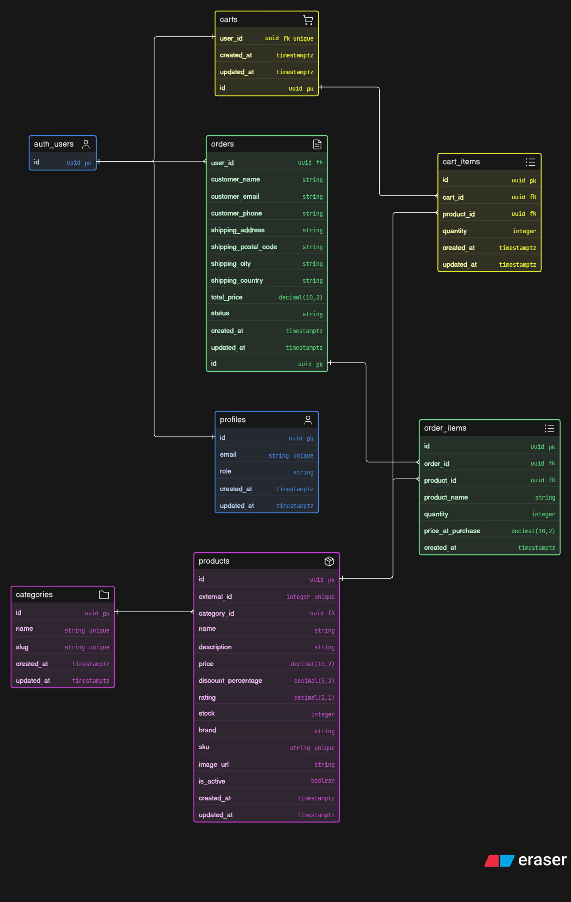

[](https://classroom.github.com/a/r1QxwNOh)

# Min egna e-handel

Detta projekt är en e-handelsplattform för skoluppgiften i systemutveckling. Appen använder React i frontend och Supabase för auth, databas och behörighet.

## Kom igång lokalt

Projektet har en frontend i `frontend/`.

Krav:

```powershell
node --version
npm --version
```

Installera beroenden:

```powershell
npm install
```

Skapa lokal miljöfil vid behov:

```powershell
Copy-Item frontend\.env.example frontend\.env.local
```

Fyll i Supabase-värden i `frontend/.env.local`:

```env
VITE_SUPABASE_URL=
VITE_SUPABASE_ANON_KEY=
```

Starta frontend:

```powershell
npm run dev
```

Standardadress:

```txt
Frontend: http://localhost:5173
```

Kontrollera TypeScript och bygg projektet:

```powershell
npm run typecheck
npm run build
```

## Deployment

Projektet är förberett för Cloudflare Pages.

Nuvarande deploy:

```txt
https://min-egna-e-handel.pages.dev
```

Senaste deployment:

```txt
https://7f5c21be.min-egna-e-handel.pages.dev
```

Rekommenderad publik adress:

```txt
https://ehandel.hampusandersson.dev
```

Cloudflare Pages-inställningar:

```txt
Project name: min-egna-e-handel
Build command: npm run build
Build output directory: frontend/dist
Node version: 20 eller senare
```

Miljövariabler som behöver läggas in i Cloudflare Pages:

```env
VITE_SUPABASE_URL=
VITE_SUPABASE_ANON_KEY=
```

Deploy via terminal:

```powershell
npm run deploy:pages
```

Lokal Cloudflare Pages-preview:

```powershell
npm run pages:preview
```

Efter första deployen kan subdomänen `ehandel.hampusandersson.dev` kopplas som custom domain i Cloudflare Pages.

## Supabase

Supabase används för:

- login med Supabase Auth
- produkter, kategorier, varukorgar och ordrar
- adminbehörighet via `profiles.role`
- RLS och databasregler

Vanliga kundkonton ska ha rollen `customer`. Administratörskonton skapas manuellt i Supabase och får rollen `admin` i profilen. Användaren ska aldrig kunna välja rollen `admin` i registreringsformuläret.

### Admin-inloggning för lärare

Ett administratörskonto finns skapat i Supabase för granskning:

```txt
E-post: teacher.admin@example.com
Lösenord: TeacherAdmin2026!
```

Logga in via `/login` och gå sedan till `/admin` för att hantera produkter och ordrar.

Mappen `supabase/` innehåller schemafiler för att dokumentera databasstrukturen i repot. Databasen finns redan i Supabase, så baseline-migrationen är främst för versionshistorik och granskning.

## Databasdiagram

Diagrammet innehåller tabeller för produkter, kategorier, användare, varukorg, order och orderrader.



Källfilen för diagrammet finns här:

`docs/diagrams/database-er-diagram.eraser.md`

## Produktdata

Projektet kommer att använda DummyJSON Products API som källa för demoprodukter. Produkterna ska inte hämtas live direkt från DummyJSON i frontend. I stället ska de importeras till Supabase och därefter läsas från projektets egen databas.

Detta gör att produkterna kan sparas, redigeras av administratör och användas i orderflödet enligt uppgiftens krav.

Importscriptet dokumenteras här:

[docs/data-import.md](docs/data-import.md)

## Sitemap

Sitemapen för e-handelsplattformen finns dokumenterad här:

[docs/planning/sitemap.md](docs/planning/sitemap.md)

## Mockups

UI-mockups för e-handelsplattformens planerade sidor finns skapade i Google Stitch:

[Öppna mockups i Google Stitch](https://stitch.withgoogle.com/projects/2797369421238320316)
